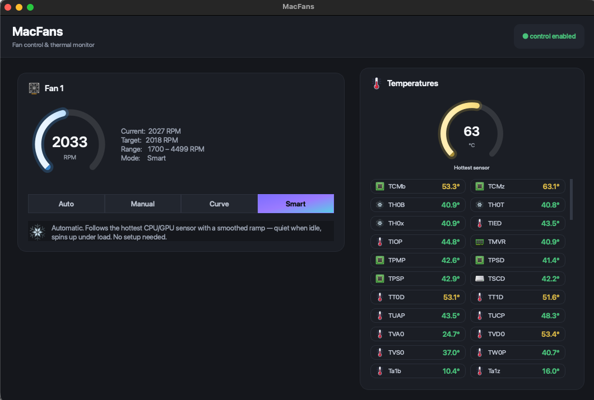

# MacFans

A small, modern Qt6 fan-control & thermal monitor for macOS, built for personal
use. It reads Apple SMC sensors and fans directly over IOKit and can drive each
fan manually or with a temperature-based curve.



Same mechanism as commercial tools like Macs Fan Control:

```
IOServiceMatching("AppleSMC") → IOServiceOpen → IOConnectCallStructMethod(index 2)
```

with an 80-byte `SMCKeyData` struct whose `data8` command field selects
read-info / read-bytes / write-bytes. Reading sensors needs no privilege;
**writing fan speeds requires root.**

## Features

- Live RPM gauge per fan + a compact two-column live temperature grid, animated
  with gradient arcs.
- Four control modes per fan:
  - **Auto** — hand the fan back to the system (`F%dMd = 0`).
  - **Manual** — fix a constant RPM with a slider.
  - **Curve** — pick a sensor and a `from temp → fan` / `to temp → fan` ramp.
  - **Smart** — fully automatic preset. Follows the hottest CPU/GPU/SoC sensor
    with an EMA-smoothed ease-in ramp (quiet at idle, spins up under load, no
    setup).
- Category icons (CPU chip, GPU board, memory, thermometer, cooling) reused from
  Macs Fan Control, matched to each SMC sensor by its FourCC.
- Menu-bar (tray) icon with hottest-sensor tooltip and a "Restore Fans to Auto".
- Settings persisted via `QSettings`. Fans are always restored to Auto on quit.

## Passwordless control (one-time setup)

Writing fan speeds needs root. Instead of asking every launch, MacFans installs
a tiny **setuid-root helper** once:

- `src/helper_main.cpp` → `macfans-helper`, bundled in `Contents/MacOS`.
- Clicking **Enable Control** runs a single `osascript ... with administrator
  privileges` that copies the helper to
  `/Library/Application Support/MacFans/macfans-helper`, `chown root:wheel`,
  `chmod 4755`.
- After that one password prompt, the app drives the fans with **no further
  prompts** — the GUI shells out to the helper, which runs as root.
- The helper only ever writes `F*` (fan) keys — a deliberately tiny attack
  surface for a setuid binary; it links no Qt.

To remove it later: `sudo rm -rf "/Library/Application Support/MacFans"`.

## Build

Requires Homebrew Qt6 and CMake (already present on this machine).

```bash
cd mac-fan-control
cmake -S . -B build -DCMAKE_PREFIX_PATH=/opt/homebrew/opt/qt6 -DCMAKE_BUILD_TYPE=Release
cmake --build build -j8
```

Output: `build/MacFans.app`.

## Install (self-contained, recommended)

```bash
scripts/install.sh          # build + bundle Qt + sign + copy to /Applications
scripts/install.sh --login  # also start MacFans at login
```

This bundles the Qt frameworks and all their dependencies into the `.app`,
applies a valid ad-hoc code signature, and installs it to `/Applications` — so
it runs on any Mac without Homebrew and without the "damaged / unidentified
developer" Gatekeeper error. Internally it runs `scripts/package.sh`
(→ `scripts/bundle_deps.py`), a small reliable stand-in for `macdeployqt`.

## Run

Monitoring works with no privileges:

```bash
open build/MacFans.app
```

To control the fans, click **Enable Control** once (see "Passwordless control"
above). The status pill turns green and Manual / Curve / Smart take effect — and
stay working across restarts with no more prompts. Running the whole app with
`sudo` also works but is no longer necessary.

## Start at login

```bash
scripts/install-launchagent.sh            # uses /Applications or ./build
scripts/install-launchagent.sh /path/to/MacFans.app
```

Installs `~/Library/LaunchAgents/local.macfans.app.plist` (`RunAtLoad`) and
starts it immediately. MacFans then launches automatically every login.

## Uninstall

```bash
scripts/uninstall.sh
```

Removes the LaunchAgent, the privileged helper (asks for your password), and
saved settings, and restores full system fan control. Delete `MacFans.app`
yourself if you copied it to `/Applications`.

## Notes & caveats

- **Verified on this Mac mini (Apple Silicon):** 1 fan (`F0`), range 1700–4499
  RPM, mode key `F0Md` present, fan/temperature keys are `flt` type — all
  handled.
- Many Apple Silicon sensor keys are undocumented FourCCs; unknown keys are
  shown by their raw code (e.g. `TCMz`). Known Intel/AS keys get friendly names
  (`src/fanmodel.cpp`, `friendlyName`).
- The app never writes anything except `F*` fan keys, and always restores Auto
  on exit — but you are forcing hardware fan speeds, so use sensible curves.
- No code signing: first `open` may need right-click → Open, or an allow in
  System Settings → Privacy & Security.

## Layout

```
src/smc.{h,cpp}        IOKit AppleSMC read/write + value (de)coding
src/fanmodel.{h,cpp}   discovery, polling, manual + curve control engine
src/gauge.{h,cpp}      animated circular gauge (QPainter)
src/mainwindow.{h,cpp} UI, tray, privilege handoff
src/main.cpp           app bootstrap + stylesheet
resources/style.qss    dark minimal theme
```
