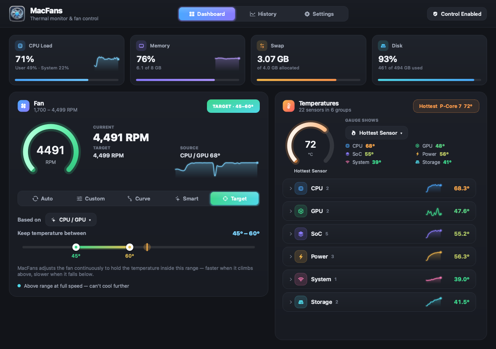
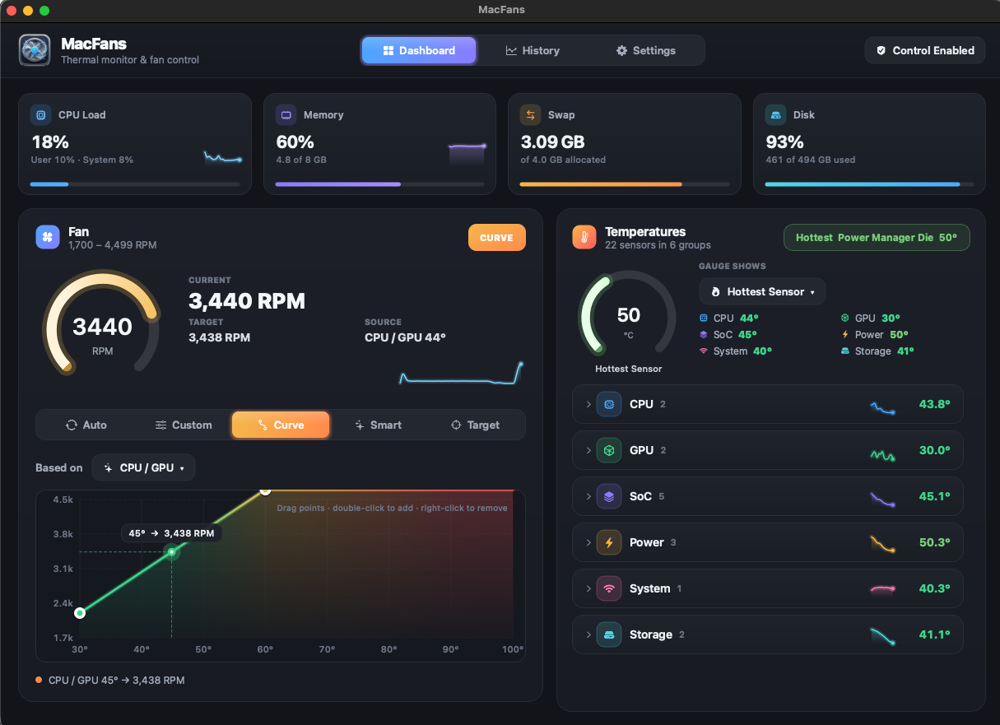
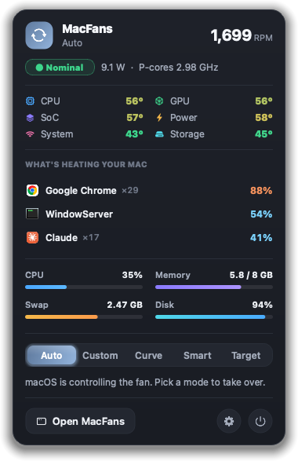
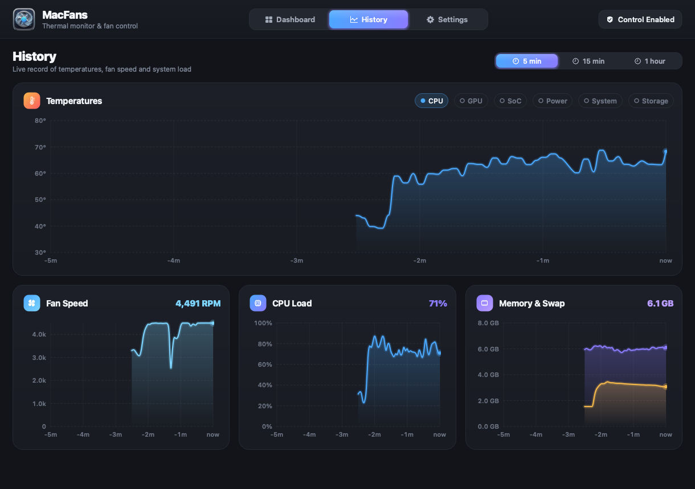
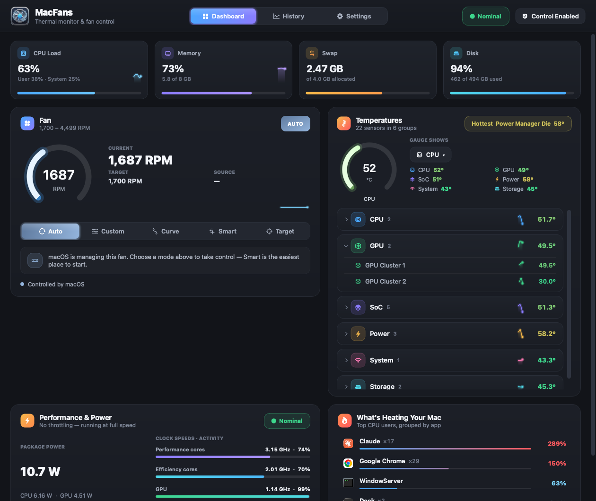
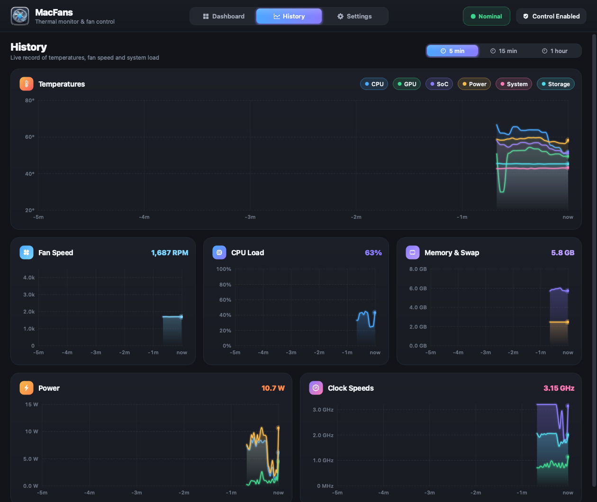
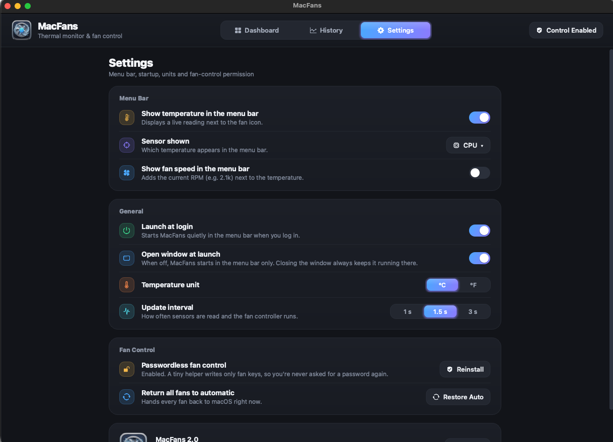

# MacFans

A modern, native-feeling **fan control & thermal monitor for Apple silicon Macs**,
built with Qt 6 and a thin AppKit bridge. It lives in the menu bar, reads Apple's
SMC and HID thermal sensors directly, and drives your fans with five control
modes — from a simple fixed speed to an adaptive controller that holds a
temperature range for you.



## Screenshots

| Graphical fan curve | Menu-bar popup |
|---|---|
|  |  |



| Thermal pressure, power, clocks & top processes | Power and clock-speed history |
|---|---|
|  |  |



## Features

### Monitoring
- **Grouped, collapsible temperature tree** — CPU (Performance / Efficiency cores
  → individual cores), GPU clusters, SoC (SoC sensors, Neural Engine, Image Signal
  Processor), Power (PMU / PMGR dies, power supply), System and Storage — each
  row with a live sparkline. Right-click any sensor to show it on the gauge or in
  the menu bar.
- **System overview** — CPU load (user / system), memory, swap and disk usage.
- **Thermal health** — the system thermal pressure (Nominal / Moderate / Heavy /
  Trapping — the same signal `powermetrics` reports) is always visible in the
  header and the menu bar, so you can see at a glance whether your Mac is
  actually being throttled.
- **Power & clock speeds** — real package power in watts (CPU and GPU, from the
  chip's energy counters) and the actual clock speed and activity of the
  performance cores, efficiency cores and GPU, computed from per-core DVFS
  residency and the chip's own frequency tables. No root needed.
- **What's heating your Mac** — the top CPU consumers, with helper processes
  folded into their app ("Chrome ×29"), app icons, and a two-step Quit.
- **History tab** — smooth, hoverable charts of temperatures (toggle each group),
  fan speed, CPU load and memory & swap over 5 minutes, 15 minutes or an hour.

### Fan control — five modes
| Mode | What it does |
|---|---|
| **Auto** | Hands the fan back to macOS. |
| **Custom** | A fixed speed: drag the slider or use Min / 25% / 50% / 75% / Max presets. |
| **Curve** | Your own temperature → speed curve, edited graphically: drag points, double-click to add, right-click to remove. Shows the live operating point. |
| **Smart** | Hands-off adaptive control with three sensitivities — **Quiet**, **Balanced**, **Cool**. Smooths the temperature, looks at its trend to anticipate rising load, and ramps up fast / down gently. Higher sensitivity reacts earlier and keeps the machine cooler. |
| **Target** | Set a range (e.g. 55–70 °C). A dead-band PI controller speeds up when the temperature climbs above it, slows down below it, and holds steady inside. |

Every temperature-driven mode has an explicit **"Based on"** picker: the hottest
of CPU / GPU (default), the hottest sensor, or **any** group or individual sensor —
e.g. make the fan follow the GPU only.

### Alerts & safety
- **Notifications** for high temperature (your sensor + threshold, with
  hysteresis), sustained throttling, and fan failure (a fan that stops or can't
  reach its target). Every alert is also kept in an in-app log.
- **Emergency cooling** — in any mode, if a sensor reaches 95° or macOS reports
  heavy thermal pressure, the fan is forced to maximum until things drop below
  85°. Protects you from, say, a low fixed speed under a heavy load.
- **Crash protection** — a detached root watchdog waits on MacFans' process;
  if the app ever crashes or is force-quit, every fan is handed back to macOS
  instead of staying stuck at a forced speed.

### Menu bar
- A native status item showing the fan icon plus a **live temperature of the
  sensor you choose** (and optionally the fan RPM, e.g. `52° · 2.1k`).
- Click it for a floating popup with temperatures, CPU / memory / swap / disk,
  all five modes and their quick controls (speed slider, Smart sensitivity,
  Target range). It never pulls the main window forward.
- **Close the window and MacFans keeps running in the menu bar** (no Dock icon).
  Optionally launch at login straight into the menu bar.

### Design
Custom-painted, animated controls — sliding segmented tabs, gradient sliders
with a range variant, toggle switches — native **SF Symbols** icons, gradient
gauges and smooth page transitions. °C / °F and the update interval are
configurable.

## How it works

- **Fans** — `IOServiceMatching("AppleSMC") → IOServiceOpen →
  IOConnectCallStructMethod` with the 80-byte `SMCKeyData` struct. Fan keys
  `F0Ac / F0Mn / F0Mx / F0Tg / F0Md` (`flt` on Apple silicon).
- **Temperatures** — Apple silicon exposes its named thermal sensors (pACC / eACC
  cores, GPU, ANE, ISP, SOC, PMGR / PMU dies, NAND) through the HID event system
  (`IOHIDEventSystemClient`), plus a few SMC proximity keys. No privileges needed.
- **System load** — Mach host statistics, `vm.swapusage`, `statfs`.
- **Power, clocks, throttling** — IOReport "Energy Model" counters (energy
  delta ÷ time), "CPU/GPU Performance States" residencies weighted by the pmgr
  `voltage-states` frequency tables, and the
  `com.apple.system.thermalpressurelevel` notification state.
- **Processes** — `ps` (setuid on macOS, so it sees every process), grouped by
  outermost `.app` bundle.
- **Passwordless control** — writing fan keys needs root. One click on **Enable
  Control** installs a tiny setuid-root helper (`macfans-helper`, no Qt, writes
  **only** `F*` fan keys) to `/Library/Application Support/MacFans/` with a
  single administrator prompt. After that the app never asks again. Writes are
  queued and coalesced so the UI never blocks.
- Fans are always returned to Auto when MacFans quits.

## Install

Download the latest `.zip` from
[Releases](https://github.com/rohamrajabzadeh/mac-fan-control/releases), unzip,
move **MacFans.app** to `/Applications`, then right-click → **Open** the first
time (the app is ad-hoc signed, not notarized). Click **Enable Control** once.

Or build and install from source:

```bash
git clone https://github.com/rohamrajabzadeh/mac-fan-control.git
cd mac-fan-control
scripts/install.sh            # build + bundle Qt + sign + copy to /Applications
scripts/install.sh --login    # …and start at login
```

`scripts/package.sh` (→ `scripts/bundle_deps.py`) makes the `.app`
self-contained: it bundles the Qt frameworks and every transitive dependency and
applies a valid ad-hoc signature, so it runs without Homebrew.

### Build only

Requires Homebrew Qt 6 and CMake.

```bash
cmake -S . -B build -DCMAKE_PREFIX_PATH="$(brew --prefix qt6)" -DCMAKE_BUILD_TYPE=Release
cmake --build build -j8
```

### Start at login / uninstall

Toggle **Launch at login** in Settings (or run `scripts/install-launchagent.sh`).
`scripts/uninstall.sh` removes the login item, the helper and saved settings.

## Notes

- Verified on a Mac mini M1 (Macmini9,1): one fan, 1,700–4,499 RPM. Sensor
  names vary between chip generations; unknown chips fall back to grouping raw
  SMC keys (Intel Macs included).
- You are overriding hardware fan control — keep curves and ranges sensible.
  MacFans clamps every request to the fan's own min / max.
- Requires macOS 13 or later.

## Project layout

```
src/smc.*            AppleSMC read/write and value encoding
src/hidsensors.*     Apple HID thermal sensors
src/sysmon.*         CPU, memory, swap and disk sampling
src/powermon.*       power (W), clock speeds and thermal pressure via IOReport
src/procmon.*        top CPU consumers grouped by app (+ procview.* list widget)
src/alerts.*         notifications: temperature, throttling, fan failure, emergencies
src/history.h        ring buffer feeding charts and sparklines
src/fanmodel.*       sensor tree, history, control engine (Curve/Smart/Target)
src/macnative.mm     AppKit bridge: SF Symbols, status item, popup panel, Dock policy
src/prowidgets.*     segmented control, sliders, range slider, toggle, buttons, source picker
src/charts.*         line charts and sparklines
src/sensortree.*     collapsible temperature tree, stat tiles
src/curveeditor.*    graphical fan-curve editor
src/fancard.*        per-fan control card
src/pages.*          Dashboard, History and Settings pages
src/traypopup.*      menu-bar status item and popup
src/mainwindow.*     window shell, tabs, permission flow
src/helper_main.cpp  the setuid helper (fan keys only) + crash watchdog
```
